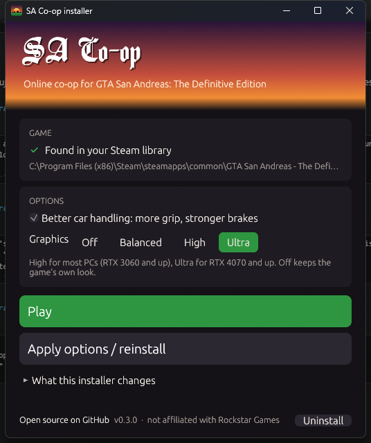

<p align="center">
  
</p>

<h1 align="center">SA Co-op</h1>

<p align="center">
  <b>Play the GTA San Andreas story together, online.</b><br>
  A co-op mod for <b>GTA San Andreas: The Definitive Edition</b> (PC, Steam). Each player on their own PC, with their own copy of the game.
</p>

<p align="center">
  <a href="https://github.com/P1tak4s/sa-de-coop/releases"></a>
  <a href="LICENSE"></a>
  
  
  
</p>

<p align="center">
  <a href="https://github.com/P1tak4s/sa-de-coop/releases/latest"><b>Download</b></a> ·
  <a href="#quick-start">Quick start</a> ·
  <a href="#features">Features</a> ·
  <a href="#faq">FAQ</a> ·
  <a href="#troubleshooting">Troubleshooting</a>
</p>

---

SA Co-op adds a **co-op** option to the game's own menu, the way Saints Row 2 did it. One player creates a session
with a name and a password, the other joins with the same two words, and you play through one story together:
shared missions, cutscenes, weather and time, riding in each other's cars, and reviving each other when one goes down.
No servers to rent, no ports to open: sessions run through Steam.

<p align="center">
  
</p>

> [!NOTE]
> **Early test build.** Most features are tested with a bot partner on one PC. A full play-through by two players
> over Steam has not been done yet, so expect rough edges. Co-op progress is saved apart from your own story, and
> your saves are backed up before anything touches them. Bug reports are very welcome in
> [Issues](https://github.com/P1tak4s/sa-de-coop/issues).

## Quick start

1. **Download** the latest `SA-Coop-<version>-windows-x64.zip` from [Releases](https://github.com/P1tak4s/sa-de-coop/releases) and unpack it.
2. **Run `SA-Coop.exe`**. It finds the game in your Steam libraries. Pick the options and click **Install**, then **Play**.
3. In the main menu pick **co-op**. One of you **creates** a session, the other **joins** with the same name and password.

Your friend does the same on their PC. The full walkthrough is in [Install (step by step)](#install-step-by-step).

## Features

| | |
| --- | --- |
| **Co-op from the menu** | A **co-op** entry in the main and pause menus opens a screen styled like the game's options. Sessions are Steam lobbies found by name and password, worldwide, with no port forwarding. |
| **One story for both** | The host's story is the one you play. Mission text, map markers and cutscenes reach both players. |
| **Together in the world** | Your friend walks, runs and drives in your world with their weapon, a name tag and a map blip. Clock, weather and wanted level are shared. |
| **Ride along** | **G** puts you in your friend's car. When it is full, or a bike, you ride on the trunk or behind the rider and can still shoot. |
| **Down, not dead** | Below 40 health you fall instead of dying. A 30-second countdown appears, and your friend holds **E** to get you up. |
| **Catch up** | **J** jumps you to your friend: into a free seat, onto the trunk, or beside them. During a mission the game offers it when you fall far behind. |
| **AI partner** | Playing alone? A Grove Street partner follows you, rides in the back, fights rival gangs, revives you and can drive you to your waypoint. Decisions come from TypeSafe Jev or OpenAI with your own key. |
| **Better graphics** | Presets from Balanced to Ultra: higher render resolution, ambient occlusion, reflections, sharper and longer shadows. An optional ReShade look is included. |
| **Better car handling** | Optional: more grip, stronger brakes, a bit more pull and less body roll, built from your own game files. |
| **Safe for your saves** | Co-op saves live apart from your own story, with automatic backups. **Uninstall** removes everything the mod added. |

**Not yet, or not tested:** full mission sync for two real players (shared enemies and money), your friend wearing
CJ's clothes, and the train mission special case.

## Requirements

- A **legally owned** copy of GTA San Andreas: The Definitive Edition on **Steam**, game build **1.0.113.49697469**.
  The mod reads game memory at fixed addresses for this build; other builds will not work.
- Windows 10 or 11 (64-bit).
- For co-op, your friend needs their own PC and their own Steam copy. Pirated copies are not supported.

## FAQ

**Is it safe to run?**
All of the source is in this repository, and the release is built from it. The installer shows exactly what it
changes and has an **Uninstall** button. Windows SmartScreen may warn because the exe is not code-signed (signing
certificates are paid); click **More info**, then **Run anyway**, or build it yourself.

**Does it ship any Rockstar files?**
No. The co-op menu entry, the fonts and the car handling are built on your PC from your own copy of the game.

**Can I get banned?**
The Definitive Edition has no online mode or anti-cheat, and the mod does not touch Rockstar's services. Sessions
go through ordinary Steam lobbies.

**Do both players need the game?**
Yes, each player needs their own Steam copy.

**Will it mess up my story save?**
No. Co-op games are saved separately, and your own saves are copied to `%LOCALAPPDATA%\sa-de-coop\saves-backup`
before the mod switches anything.

**Does it work with the original 2004 game or the Rockstar Games Launcher version?**
No, only the Steam version of the Definitive Edition, build 1.0.113.49697469. For the classic game, see
[SA:COOP](https://github.com/Karimov-Akbar/sa-coop).

## Install (step by step)

1. Close the game.
2. Open [**Releases**](https://github.com/P1tak4s/sa-de-coop/releases) and download `SA-Coop-<version>-windows-x64.zip`.
3. Unpack the zip anywhere, for example to `Downloads\SA-Coop`. Keep the `files` folder next to `SA-Coop.exe`.
4. Run **`SA-Coop.exe`**. Windows SmartScreen may warn about an unknown app: click **More info → Run anyway**
   (the exe is not code-signed; you can build it yourself, see [Build from source](#build-from-source)).
5. The installer finds the game by itself in all your Steam libraries. Pick the options (better car handling,
   graphics preset) and click **Install**. It:
   - copies the mod loader (Ultimate ASI Loader, CLEO Redux), `coopnet64.asi` and the scripts into
     `...\GTA San Andreas - The Definitive Edition\Gameface\Binaries\Win64`
   - builds the **co-op** menu entry on your PC from your own game files (nothing from Rockstar is in the download)
   - copies the menu fonts from your own game files
   - sets the graphics preset and car handling you picked
6. Click **Play** (or start the game from Steam as usual). You should see **co-op** in the main menu.

Your friend does the same on their PC.

## Play with a friend

Both of you must be logged in to Steam.

1. **Host** (the one whose story you play): in the main menu pick **co-op**, open the **Create** tab, type a session
   name and a password, and press **Create session**. Then load a save or start a new game.
2. **Friend**: in the main menu pick **co-op**, open the **Join** tab, type the **same** name and password, press
   **Join**, then load a save. You are placed in the host's world.
3. In game you can open the co-op screen any time: **Esc → co-op**, or **F9**.

The host's story is the one you both play. The friend's own story is not touched (see [Saves](#saves)).

## Controls

| Key | What it does |
| --- | --- |
| **F9** or **Esc → co-op** | open / close the co-op screen |
| **G** (next to your friend's car) | ride along: a free seat, or on the trunk / behind the rider on a bike when the car is full (you can shoot from there) |
| **F** / **Enter** | get out of the car, or get off the trunk / bike |
| **E** (hold 3 s next to a downed friend) | revive them |
| **H** (AI partner, next to a car) | the partner drives you to your map waypoint; **H** again to stop |

## AI partner (playing alone)

Turn it on in the co-op screen. A Grove Street member joins you: he follows you, gets into the back seat of your car,
shoots rival gangs, revives you when you are down, and you can revive him the same way (hold **E**). Next to a car,
**H** makes him drive you to the waypoint you set on the map.

His decisions come from [TypeSafe Jev](https://typesafe.ai). You need your own key, in this text file:

```
%USERPROFILE%\.config\jev\.env
```

with one line: `TYPESAFE_API_KEY=your-key`.

Or use OpenAI instead: put `OPENAI_API_KEY=your-key` in `%USERPROFILE%\.config\openai\.env` (optionally a second
line `OPENAI_MODEL=...`, default `gpt-6-luna`). When that file exists, OpenAI is used. Keys are read only from these
files on your PC; only a one-line description of the situation is sent.

Without any key he still follows you and shoots enemies close to you.

## Better graphics

**Presets (in the installer):** pick **Off / Balanced / High / Ultra** in `SA-Coop.exe` and click **Install** or
**Save options**. It writes the game's `Engine.ini`; restart the game to see the change.

| Preset | For | What it adds |
| --- | --- | --- |
| Balanced | any GPU | sharper image, longer view distance, better shadows, no motion blur |
| High | RTX 3060 / RX 6600 and up | 125 % render resolution, better anti-aliasing, ambient occlusion, reflections on wet roads and cars, longer shadows |
| Ultra | RTX 4070 / RX 7800 XT and up | 150 % render resolution, 8K shadows, the longest view distance |

Your own `Engine.ini`, if you had one, is kept as `Engine.ini.before-sa-coop`; **Off** puts it back.

**ReShade (optional, a different look):**

1. Download [ReShade](https://reshade.me) and run its setup. Pick `SanAndreas.exe` in
   `Gameface\Binaries\Win64`, choose **DirectX 10/11/12**, and tick the effect packages **Standard effects** and
   **qUINT by Marty McFly**.
2. Copy `extra\reshade\SA-Coop-ReShade.ini` from the release into the same `Win64` folder.
3. In game press **Home**, choose `SA-Coop-ReShade.ini` as the preset. **Scroll Lock** turns the effects on and off.

The preset adds a light sharpen, a little more colour and contrast, and removes banding in the sky.

## Saves

The co-op screen has a **Mine / Co-op** switch. Co-op games are saved separately, so a co-op session never
overwrites your own story. Before switching, the mod copies your saves to `%LOCALAPPDATA%\sa-de-coop\saves-backup`.

## Troubleshooting

- **No co-op entry in the menu**: run `SA-Coop.exe` again and press **Save options**. **F9** still opens the
  co-op screen in game.
- **The game crashes at start**: check that your game build is 1.0.113.49697469 (Steam may have updated the game).
  The mod's log is `%LOCALAPPDATA%\sa-de-coop\coopnet.log`; please open an issue with it.
- **Crash at start with DirectX errors**: install the
  [DirectX End-User Runtimes (June 2010)](https://www.microsoft.com/en-us/download/details.aspx?id=8109).
- **Friend cannot join**: both must type exactly the same session name and password, and both must be online in Steam.
- **Camera feels slow up and down**: raise **Mouse Sensitivity Y** in the game's control settings.
- Script messages are logged in `Gameface\Binaries\Win64\cleo_redux.log`.

## Uninstall

The installer has an **Uninstall** button. By hand: delete these from `Gameface\Binaries\Win64`: `version.dll`, `cleo_redux64.asi`, `coopnet64.asi` and the `CLEO`
folder. Delete `Gameface\Content\Paks\~mods\coop_P.pak`. If the installer created your `Engine.ini`
(`Documents\Rockstar Games\GTA San Andreas Definitive Edition\Config\WindowsNoEditor\Engine.ini`), delete it too.
Your saves stay where they are.

## Build from source

| Part | What it does |
| --- | --- |
| `proto/` | wire format (80-byte player state, events, join code) |
| `relay/` | UDP relay server for the direct IP mode (testing), UPnP |
| `coopnet/` | `coopnet64.asi`: networking (Steam lobby + P2P, or UDP), the in-game co-op screen (hudhook / Dear ImGui), the menu hook, AI partner calls |
| `game/CLEO/` | CLEO Redux scripts: friend sync, passenger, revive, names, world sync, your car, AI partner |
| `launcher/` | `SA-Coop.exe`: the installer (finds the game, installs, graphics, car handling, Play) |
| `menu-mod/tool/` | MenuPatch (UAssetAPI): adds the co-op entry to the game's menu templates |
| `tools/` | `dll_test.py` (loopback test without the game), `botas.py` (a test friend bot) |

Needs Rust stable (MSVC toolchain), CMake and the .NET 8 SDK.

```
cargo build --release
dotnet publish menu-mod/tool -c Release -r win-x64 --self-contained -p:PublishSingleFile=true -p:PublishTrimmed=true -p:TrimMode=partial -p:EnableCompressionInSingleFile=true
```

`target/release/coopnet64.dll` is installed as `coopnet64.asi`. Release zip layout: `SA-Coop.exe` (from
`target/release/sa-coop.exe`), `README.txt`, and `files/` with `game/` (the files from `game/` plus `coopnet64.asi`)
and `extra/` (`MenuPatch.exe`, `repak.exe`, `Engine.ini` and `graphics/` from `game-config/`, `reshade/`).
The installer window shows the game's art and logo from the player's own Steam library cache; none is shipped.

## Credits and licence

[CLEO Redux](https://re.cleo.li) by Seemann, [Ultimate ASI Loader](https://github.com/ThirteenAG/Ultimate-ASI-Loader)
by ThirteenAG, [hudhook](https://github.com/veeenu/hudhook), [repak](https://github.com/trumank/repak),
[UAssetAPI](https://github.com/atenfyr/UAssetAPI). Ideas from [SA:COOP](https://github.com/Karimov-Akbar/sa-coop)
for the classic game. Third-party files keep their own licences (included).

Code in this repository: [MIT](LICENSE).

Not affiliated with or endorsed by Rockstar Games or Take-Two Interactive. Grand Theft Auto and San Andreas are their
trademarks. This mod contains no game files; you need your own copy of the game.
